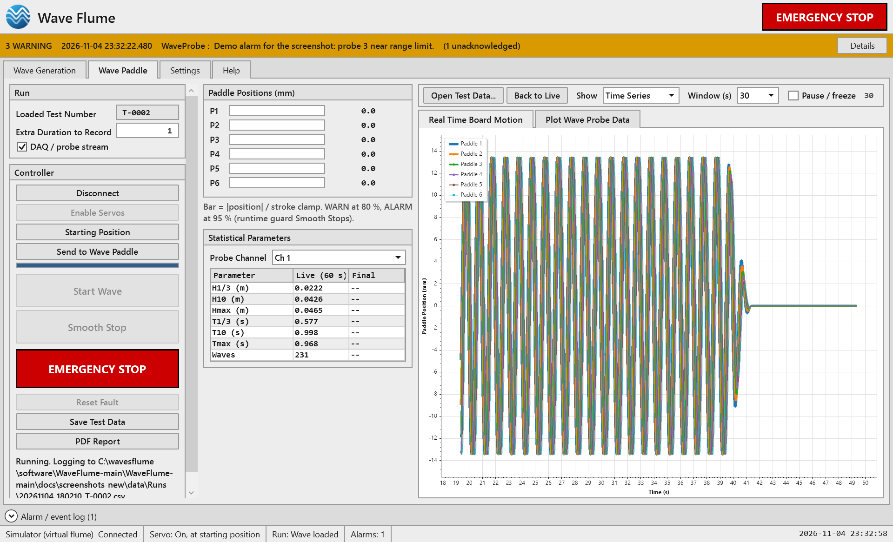

# Wave Flume — 6-paddle wavemaker control (.NET 8)

Control program for a 3.0 m x 45.0 m wave flume with six paddles. Operator guide: [docs/USER_MANUAL.md](docs/USER_MANUAL.md)
([PDF](docs/Wave_Flume_User_Manual.pdf)).
The product makes Monochromatic waves and Random waves (Generalised Pierson-Moskowitz or JONSWAP spectrum); the other
generators stay in the engine but are not offered in the screen. Full specification: [docs/SPECIFICATION.md](docs/SPECIFICATION.md).



## Build and test

Requires the .NET 8 SDK (`winget install Microsoft.DotNet.SDK.8`).

```bash
dotnet build WaveFlume.sln
```

```bash
dotnet test WaveFlume.sln
```

`Directory.Build.props` sets C# 12, nullable, and warnings-as-errors for every project.

## Run the desktop app

```bash
dotnet run --project src/WaveFlume.App
```

Windows only (WPF). The first run uses the **Simulator** (virtual flume), so no PLC is needed. Settings live in
`%LOCALAPPDATA%\WaveFlume\settings.json` (TagMap profiles in `plc_profiles\` beside it, logs in `logs\`);
recipes and run CSVs go to `Documents\WaveFlume\`.

Before anything can be sent: Settings (no login; anyone can change them) → enter
**Max Acceleration** → Save. Then Wave Generation → Calculate → Wave Paddle → Connect, Enable Servos, Home,
Send to Wave Paddle, Start Wave.

### Data storage

There is no database. Recipes are kept in `recipes.json` and each run is written as a CSV (plus a PDF report) in
the data directory (`Documents\WaveFlume\` by default, changeable in Settings).

### Probe calibration

`Probe_m` in the TagMap carries loop current in mA. Settings → Channels and Calibrations: dip a probe at ≥ 3 known
elevations, **Capture point** at each, **Fit** (least squares, R² and residuals), **Save**. Uncalibrated
channels use the nominal range in `flume_config.json` → `Probes`. Below 3.8 mA or above 20.5 mA on an active channel
raises a Critical alarm and commands Smooth Stop.

### Reports

Every completed run gets `Runs\<run>.pdf` next to its CSV (recipe, kinematics, limit utilisation, paddle and
elevation plots, measured spectrum, statistics per probe, alerts). **PDF Report** on the Wave Paddle tab rebuilds it,
or reports on an opened test-data CSV. QuestPDF is used under its Community licence: free for organisations below
USD 1M annual revenue, non-profits and academic use — confirm eligibility before distribution.

## Release build

```bash
powershell -File installer/build-release.ps1
```

Builds the PDF manual (`installer/make-manual-pdf.ps1`: Markdig tool in `tools/md2html` plus Microsoft Edge), runs the
tests, publishes a self-contained single-file `WaveFlume.exe` (win-x64, ~216 MB, no .NET install needed) to
`artifacts/publish`, extracts `plctag.dll` (libplctag native library, shipped by the installer so the app never writes
into Program Files), and compiles `installer/WaveFlume.iss` (Inno Setup 6) to
`artifacts/installer/WaveFlume_Setup_<version>.exe`.

The installer also installs the Microsoft Visual C++ runtime when it is missing (`installer/prereq/vc_redist.x64.exe`,
from https://aka.ms/vs/17/release/vc_redist.x64.exe; this file is not stored in the repository, so download it first,
see `installer/prereq/README.txt`), and asks for the controller type and address and the data folder.
It writes the answers to `config\install_defaults.json`, which the program applies when it first creates its settings.
`installer/make-logo.ps1` and `installer/make-wizard-images.ps1` redraw the logo and the setup pictures.
Silent install for several PCs: `/VERYSILENT /Controller=real /Protocol=OmronFins /Ip=192.168.250.1 /Port=9600 /DataDir="D:\FlumeData"`.

The Help tab opens `docs\Wave_Flume_User_Manual.pdf` and, when `config\manual_link.txt` holds a web address, shows
a link to an online copy.

Screenshots of every tab in both themes (`docs/screenshots/`) are regenerated with:

```bash
dotnet run --project src/WaveFlume.App -- --screenshots docs/screenshots-new
```

That runs the golden wave on the simulator with a throw-away settings file inside the target folder.

## Layout (current)

```
WaveFlume.sln
Directory.Build.props
config/flume_config.json           physical flume, limits, ranges (SI units)
config/plc_profiles/*.json         TagMap profiles: Omron FINS (DM), Modbus TCP (HR), OPC UA (NodeIds)
src/WaveFlume.Core/                enums, HardLimits, Units, FlumeConfig, WaveRequest, Trajectory, SafetyReport,
                                   TelemetrySnapshot, Alert
src/WaveFlume.Physics/             Dispersion, TransferFunctions, Ramp, WaveComponent + OrientationPhase,
                                   TrajectoryGenerator, SafetyGatekeeper, LimitCurve, WaveStatistics, WaveMathEngine
src/WaveFlume.Plc/                 IPlcDriver + records, TagMap, WordCodec, TrajectoryChunker + Crc16,
                                   TagMapDriverBase/WordDriverBase, ModbusTcp/OmronFins/OpcUa/EtherNetIp/S7 drivers,
                                   SimulatorDriver, DriverFactory + NetworkHint, PlcTelemetryService, PlcIoMap
src/WaveFlume.Data/                CsvLogger, TestDataFile (CSV reader), ProbeCalibration
src/WaveFlume.Reporting/           PdfReportService (QuestPDF + ScottPlot PNGs)
src/WaveFlume.App/                 WPF: Themes (Light/Dark/Controls), Views, ViewModels, Services
                                   (AppState, SettingsStore + DPAPI, RecipeStore, PlcSession, AlarmService, AlarmAdvice)
tests/WaveFlume.*.Tests/           xUnit + FluentAssertions (Plc tests use loopback fake FINS/Modbus servers;
                                   App tests drive the view-models and the real window against the simulator)
installer/                         WaveFlume.iss (Inno Setup), build-release.ps1, make-manual-pdf.ps1, make-logo.ps1,
                                   make-wizard-images.ps1, prereq/ (see prereq/README.txt)
tools/md2html/                     build tool: user manual Markdown -> HTML (printed to PDF by make-manual-pdf.ps1)
docs/                              USER_MANUAL (.md and .pdf), SPECIFICATION, PLC_IO_MAP (generated), UI_STYLE_GUIDE,
                                   TODO_VERIFY, screenshots/
```

`docs/PLC_IO_MAP.md` is generated from the profiles; after editing a profile run:

```bash
WAVEFLUME_REGEN_DOCS=1 dotnet test WaveFlume.sln
```

## Running against the virtual flume

```csharp
await using var plc = DriverFactory.Create(PlcProtocolType.Simulator, null);
await plc.ConnectAsync(new PlcEndpoint(), ct);
var telemetry = new PlcTelemetryService(plc, new TelemetryOptions());
telemetry.Start(new PlcEndpoint());
_ = CsvLogger.WriteAsync(telemetry.BeginCsvCapture(), "Runs/" + CsvLogger.RunFileName(DateTime.UtcNow, "T-01"), header, 6, 3, ct);
```

## Usage

```csharp
var cfg = FlumeConfig.Load("config/flume_config.json");
var result = new WaveMathEngine(cfg).Calculate(new WaveRequest { WaterDepthM = 0.6, WaveHeightM = 0.05, PeriodS = 1.0 });
if (!result.Safety.Ok) { /* show result.Safety.Violations[0].Message in red; nothing is sent */ }
```

`MaxAccelMs2` is `null` in the shipped config, so every calculation reports `ACCEL_NOT_CONFIGURED` until it is entered in Settings (spec §2).

## Safety note

The PC is supervisory and non-real-time. The hardwired E-stop chain is the primary stop and the PLC must enforce the same stroke, velocity and acceleration limits independently.
