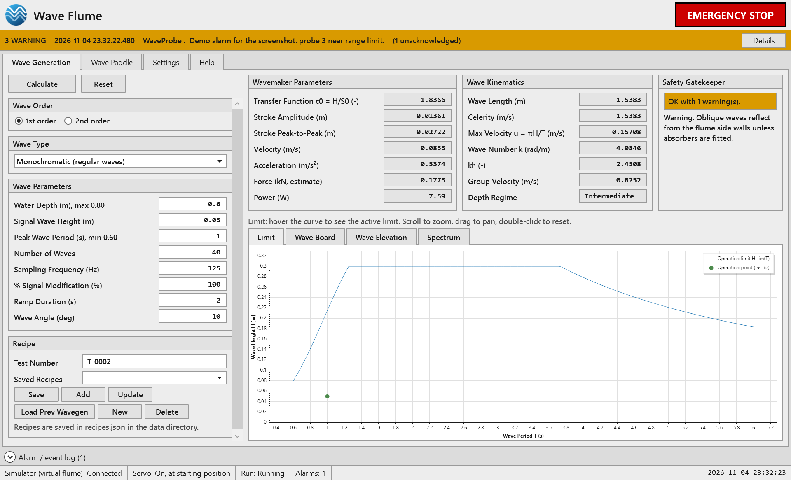
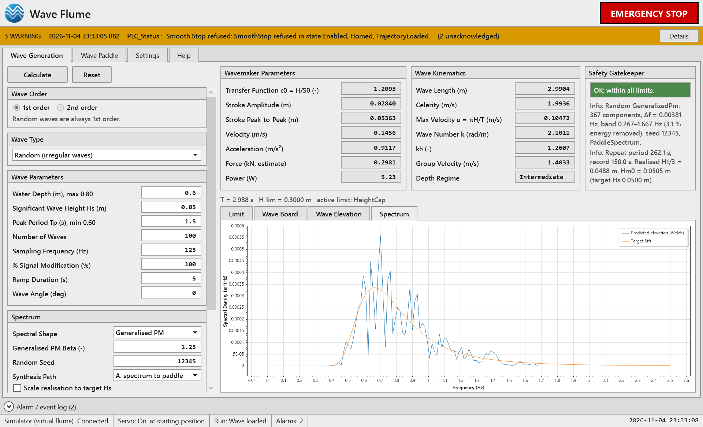
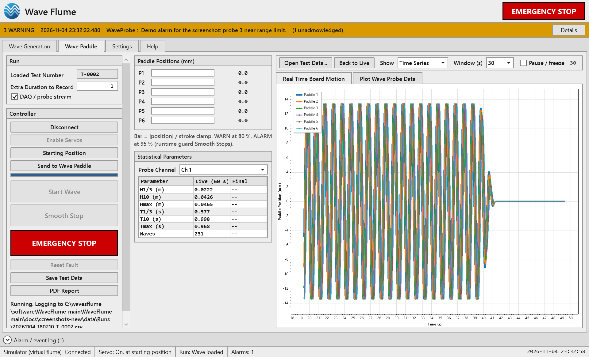
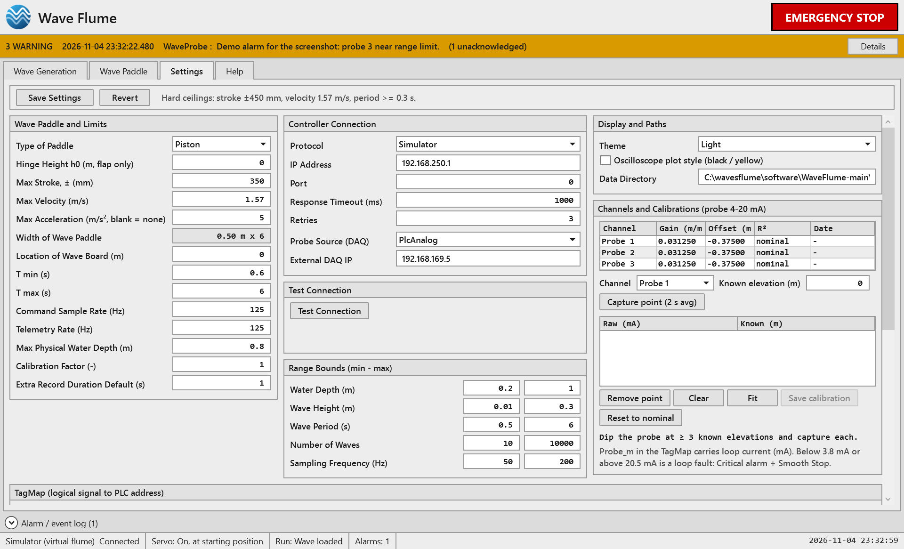
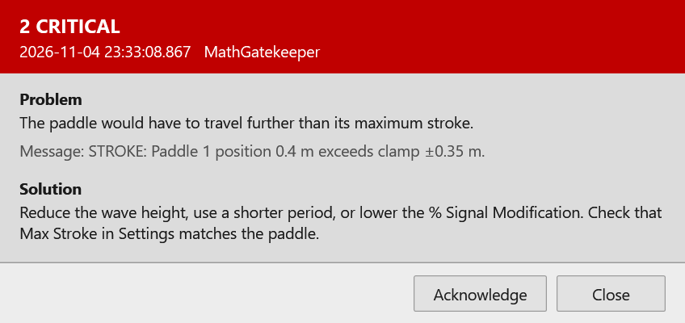

# Wave Flume User Manual

Version 1.0

Wave Flume controls a wave flume (3.0 m wide, 45.0 m long) with six paddles. You describe the wave you want, the
program works out how the paddles must move, checks that this is safe, sends it to the controller, runs it, and
records what the wave probes measure. It makes two kinds of wave:

- **Monochromatic**: regular waves of one height and one period.
- **Random**: an irregular sea state, from a **Generalised Pierson-Moskowitz (PM)** or a **JONSWAP** spectrum.

> **Safety.** The PC supervises the flume but is not a real-time safety system. The hardwired emergency stop is the
> main way to stop the paddles. The on-screen EMERGENCY STOP is an additional request. The controller and drives
> must apply their own stroke, speed and acceleration limits independently of this program.

---

## 1. Installing and starting the program

**Installing.** Run **WaveFlume_Setup_1.0.0.exe** and follow the steps. Windows asks once for permission to install
(the program itself has no login or password). Setup:

1. installs Wave Flume (no other software is needed; the .NET runtime is included);
2. installs the **Microsoft Visual C++ runtime** if your PC does not already have it;
3. asks **how Wave Flume should connect to the flume**: the built-in **Simulator** (no hardware), or the **real
   controller** with its type (Omron FINS, Modbus TCP, OPC UA, EtherNet/IP or Siemens S7), address and, if needed, port;
4. asks which **data folder** to use for recipes and results (the default is `Documents\WaveFlume`);
5. creates the Start menu entries (and a desktop icon if you tick it).

Everything chosen in setup can be changed later in the program (Settings tab). Uninstalling removes the program but
keeps your settings, recipes and results.

To install on several PCs without questions, run setup from a command prompt, for example:
`WaveFlume_Setup_1.0.0.exe /VERYSILENT /Controller=real /Protocol=OmronFins /Ip=192.168.250.1 /DataDir="D:\FlumeData"`.

**Starting.** Start **Wave Flume** from the Start menu or the desktop icon. The window opens full screen.

The first time, the program uses the **Simulator**, a virtual flume, so no controller or hardware is needed. This
is the safe way to learn it.

## 2. Quick flow (read this first)

Each step unlocks the next. The program greys out any button that is not allowed yet.

**First time only**
1. Settings tab: type the **Max Acceleration** of your drive, then press **Save Settings**.

**Every test**
1. **Wave Generation tab:** choose the Wave Type, fill in the numbers, press **Calculate**. The Safety Gatekeeper box must not be red.
2. *(Optional)* Type a Test Number and press **Save** to keep the wave as a recipe.
3. **Wave Paddle tab:** press **Connect**, **Enable Servos**, **Starting Position**, **Send to Wave Paddle**, then **Start Wave**, in that order.
4. Press **Smooth Stop** to end the run. Press **EMERGENCY STOP** in an emergency.
5. The data (CSV) and the report (PDF) are saved automatically in the Runs folder.

### Why each Wave Paddle button is needed

| Button | What it does | Why it is in the sequence |
|---|---|---|
| Connect | Opens the link to the controller. | Nothing else works without it. |
| Enable Servos | Switches on the servo drives. | The paddles cannot move until the drives are on. |
| Starting Position | Moves the paddles to their starting (zero) position. | After switch-on the drives do not know where the paddles are. This step defines the paddle zero. Every calculated wave starts from zero, so without it the paddle could start from the wrong place and run into its end stop. The controller will not accept Start until the paddles are at the starting position. It is needed once after the servos are switched on. |
| Send to Wave Paddle | Sends the calculated wave to the controller. | Start has nothing to run until a wave is loaded. |
| Start Wave | Starts the wave. | |
| Smooth Stop | Ends the wave gently. | |
| EMERGENCY STOP | Stops at once. | Always available once connected. |
| Reset Fault | Clears a fault after its cause has been removed. | Only offered when there is a fault. |

### Which buttons you can press when

The state is shown in the status bar as "Run: ...".

| Run state (status bar) | Meaning | Buttons available |
|---|---|---|
| Disconnected | Not linked to the controller | Connect |
| Connected | Linked, drives off | Enable Servos, Disconnect, Emergency Stop |
| Servos on | Drives on | Starting Position |
| At starting position | Paddles at zero | Starting Position, Send to Wave Paddle |
| Wave loaded | A wave is loaded | Starting Position, Send (to replace it), **Start Wave** |
| Running | The wave is running | **Smooth Stop**, Emergency Stop |
| Stopping | Finishing the stop | Emergency Stop |
| Fault | Something went wrong | **Reset Fault**, Emergency Stop |

A greyed button is not broken. It is simply not allowed in the current state.

## 3. The screen

- **Title bar** with the red **EMERGENCY STOP**, always visible.
- **Alarm bar**: appears under the title when an alarm needs attention (see section 9).
- **Tabs:** Wave Generation, Wave Paddle, Settings, Help.
- **Alarm / event log** (collapsible, above the status bar).
- **Status bar:** controller, servo state, run state, alarm count, user mode, clock.
  A yellow cell appears if Max Acceleration has not been set.

Keyboard: the underlined letter on a button works with Alt (for example Alt+C = Calculate).

## 4. Setting up (first time)

Nothing can be sent until the acceleration limit is entered, because it has no default on purpose.

1. Settings tab, **Wave Paddle and Limits:** enter **Max Acceleration (m/s²)** for your drive, and check Max Stroke,
   Max Velocity, T min, T max and Max Physical Water Depth.
2. Press **Save Settings**. Use **Revert** to throw away changes.

There is no login or password: anyone using the program can change the settings. Theme and plot style are applied
as soon as you change them.

## 5. Making a wave (Wave Generation tab)

Press **Calculate** (always at the top left) after changing anything. Changing any number clears the last
calculation, so an old wave can never be sent by mistake.

### Monochromatic

| Input | Meaning |
|---|---|
| Water Depth | Depth in the flume, up to the maximum shown. |
| Signal Wave Height | Wave height H, crest to trough. |
| Peak Wave Period | Wave period T (shortest allowed is shown). |
| Number of Waves | How many waves; the test lasts Number x Period. |
| Sampling Frequency | Command rate, 125 Hz is normal. |
| % Signal Modification | Scales the whole paddle motion. 100 is normal. Above 100 you are asked to confirm. |
| Ramp Duration | Time to build up and fade out, so the paddles never start or stop suddenly. |
| Wave Angle | 0 gives a straight wave. A non-zero angle makes an angled wave. |
| Wave Order | 1st order is the standard wave. 2nd order adds a correction for a more accurate wave shape. |

### Random

Height is the significant wave height **Hs**, and the period is the peak period **Tp**.

| Input | Meaning |
|---|---|
| Spectral Shape | **Pierson-Moskowitz (PM)**, **Generalised PM**, **JONSWAP**, **TMA (shallow water)** or **Darbyshire**. |
| Beta (Generalised PM) | Shape of the spectrum. 1.25 gives the standard Pierson-Moskowitz. Larger is narrower. |
| Gamma (JONSWAP and TMA) | Peak sharpness. 3.3 is standard. 1 gives Pierson-Moskowitz. |
| Random Seed | The same seed makes exactly the same sea every time. A different seed makes a different sea. |
| Scale realisation to target Hs | Adjusts the generated sea so that its measured Hs equals the Hs you typed. Without it, one seed can scatter about 10 %. |
| Synthesis Path | A or B. Both give the same paddle motion. |

Random waves are always 1st order.

**Good practice for random waves**
- Use at least **100 waves**. Fewer give statistics that do not represent the sea state.
- The paddles can only make periods between **T min (0.6 s)** and **T max (6 s)**. A peak period outside this range is
  refused. A peak period close to either end loses part of the spectrum, because the waves at the other side of
  the peak are too short or too long for the machine. When more than 5 % of the energy is left out, the program
  shows a yellow warning and tells you how much lower Hs will be. As a guide, for JONSWAP the share left out is
  about 66 % at Tp 0.6 s, 21 % at 0.8 s, 10 % at 1.0 s and 2 % at 1.5 s; the Generalised PM loses a little more.
  Between about 1.5 s and 3 s almost nothing is lost.

### The other waves

All of these are chosen in the **Wave Type** list. Height and period always mean the numbers in the Wave Parameters box;
the extra boxes appear only for the wave that needs them.

| Wave | What it is | Extra inputs |
|---|---|---|
| **Bichromatic** | Two regular waves added together, which makes a repeating wave group. | Wave Height H2 and Wave Period T2 (second wave). |
| **Cnoidal** | A long, regular wave in shallow water: narrow sharp crests and long flat troughs. | None. Best when the wave is long compared with the depth. |
| **Solitary** | One single crest, with no trough. | None. Height H and depth h only. |
| **Focusing** | Many waves timed to meet at one place and time, making one large wave group. | Focus Position x_f and Focus Time t_f. |
| **User-defined wave** | You supply the surface elevation you want, and the program works out the paddle motion. | CSV file (Browse...). |
| **User-defined stroke** | You supply the paddle motion directly. It is still safety-checked. | CSV file (Browse...). |

The CSV file has two columns, `time_s` and `value_m`. A stroke file may hold one column for all paddles or one column per paddle.

Notes for each wave:

- **Bichromatic.** The group repeats at the beat period T1·T2 / |T2 − T1|. Both periods must be inside the paddle range.
- **Cnoidal.** The program solves for the shape from the height, period and depth (see section 11). If the wave is not long enough for the theory
  (Ursell number below 10) a yellow warning, CNOIDAL_RANGE, tells you; the wave can still be sent. A period that no cnoidal wave of that height
  and depth can have is refused with a message giving the allowed range.
- **Solitary.** Height must be below the breaking limit for the depth (about 0.78 h).
- **Focusing.** The focus position should be inside the flume and the focus time later than the ramp.
- **2nd order** is available for Monochromatic waves only. The correction (Madsen) is derived for one regular wave and is not applied to the others.

### What you see after Calculate

- **Safety Gatekeeper:** green = OK, yellow = OK with warnings (read them), **red = BLOCKED, nothing can be sent**.
- **Wavemaker Parameters:** stroke, velocity, acceleration, force and power the paddles need.
- **Wave Kinematics:** wave length, speed, wave number, depth regime.
- **Plots:** *Limit* (the highest wave allowed for each period, with your wave marked), *Wave Board* (paddle motion),
  *Wave Elevation* (predicted surface at the paddles), *Spectrum* (target and predicted spectrum, for Random).

At a wave angle of 0 all six paddles move together, so the six lines on the Wave Board plot lie on top of each
other. They are drawn from thickest (Paddle 1) to thinnest (Paddle 6) so every colour stays visible. With an
angle, the paddles are shifted in phase and the lines separate.

### If the wave is BLOCKED

The program never sends a wave that would break a limit. Press **Details** on the alarm bar for the cause and the fix. The usual causes:

| Message code | Problem | What to do |
|---|---|---|
| ACCEL_NOT_CONFIGURED | Max Acceleration not entered | Enter it in Settings and press Save Settings |
| DEPTH_RANGE, HEIGHT_RANGE, NUM_WAVES_RANGE, FS_RANGE | An input is outside its allowed range | Use a value inside the range in the message |
| PERIOD_RANGE, PERIOD_FLOOR | Period (or Tp) outside what the paddles can make | Use a period between T min and T max |
| BREAKING | Wave too high for the depth and period | Lower the height, lengthen the period or deepen the water |
| STROKE | Paddle would travel too far | Lower the height, shorten the period or lower % Signal Modification |
| VELOCITY, ACCELERATION | Paddle would move too fast or accelerate too hard | Lower the height or lengthen the period |
| PHASE_STEP | Wave angle too large for this period | Reduce the angle or lengthen the period |

Yellow warnings (the wave can still be sent): URSELL and SHALLOW_KH (calculation less accurate in very shallow
water), OBLIQUE_WALLS (angled waves reflect from the side walls), BAND_LIMITED (part of a random sea is left out),
LARGE_TRAJECTORY (a very long test).

### Number boxes

If you type something that is not a number (for example "abc" or "0.5x"), it is not used: when you leave the box
it goes back to the number that is in use. What is on screen is always what the program uses. A comma is read as
a thousands separator on this PC, so "0,05" means 5, which the range checks then refuse.

## 6. Running the wave (Wave Paddle tab)

Work down the **Controller** group as in section 2. While running:

- **Paddle Positions** bars turn **WARN** at 80 % and **ALARM** at 95 % of the stroke limit. At 95 % the paddles
  are told to stop smoothly.
- **Real Time Board Motion** and **Plot Wave Probe Data** show live data. **Show** switches between Time Series
  and Spectrum, **Window** sets 10, 30 or 60 seconds, **Pause / freeze** holds the plot.
- **Statistical Parameters** show H1/3, H10, Hmax, T1/3, T10, Tmax and the wave count for the chosen probe, for
  the last 60 s ("Live") and for the whole run ("Final").
- **Smooth Stop** ends the run gently. Recording carries on for the **Extra Duration to Record** you set.

### Data and reports

After a run the CSV and PDF are saved automatically in the **Runs** folder.

- **Save Test Data** copies the run CSV where you choose.
- **PDF Report** rebuilds the report for the opened test data file, or for the last run, and then tells you
  where it is saved: *"This wave report is saved as a PDF report in this location: (folder) with the name: (file name)"*.
- **Open Test Data...** loads an earlier CSV for review. **Back to Live** returns to live data.

Files are named `date_time_TestNumber`, for example `20261104_085419_T-0002.pdf`. **The date and time in the
name are UTC**, not local time.

Where things are kept:

| What | Where |
|---|---|
| Recipes | `recipes.json` in the data folder |
| Run data and reports | `Runs` folder inside the data folder |
| Data folder | Your Documents folder, in `WaveFlume` (if OneDrive is on, this is inside `OneDrive\Documents`). Change it in Settings. |
| Settings, program logs | `%LOCALAPPDATA%\WaveFlume` |

## 7. Recipes (saved waves)

A recipe is the saved inputs of one test, kept under a **Test Number**. It lets you repeat a wave without retyping.

| Button | What it does |
|---|---|
| Save | Stores the current inputs under the Test Number typed (must be new) |
| Add | Stores them under the next free test number |
| Update | Overwrites the recipe with that test number |
| Load Prev Wavegen | Loads the selected saved recipe |
| New | Starts a fresh recipe |
| Delete | Removes the selected recipe |

A recipe holds only the inputs. After loading one, press **Calculate** again so the safety check uses the current
limits. To give recipes to another PC, copy `recipes.json` into that PC's data folder (this replaces its recipes).

## 8. Settings reference

- **Wave Paddle and Limits:** paddle type (Piston or Flap), hinge height (flap only), max stroke, velocity and
  acceleration, T min and T max, command and telemetry rates, max water depth, calibration factor, default extra
  record time.
- **Controller Connection:** protocol, IP address, port, timeout, retries and options for the chosen protocol.
  Press **Test Connection** before connecting. **Simulator** needs no hardware.
- **Range Bounds:** the allowed minimum and maximum for depth, height, period, number of waves and sampling rate.
- **Display and Paths:** theme (Light or Dark), oscilloscope-style plots, data folder.
- **Channels and Calibrations:** probe calibration (below).
- **TagMap:** links each logical signal (position, status, and so on) to an address in the controller. Choose a
  profile, edit rows if needed, then **Validate all tags**. **Connect stays disabled while the TagMap fails
  validation.** Profiles can be imported and exported.

Press **Save Settings** to keep changes.

### Probe calibration

Probe signals arrive as a current of 4 to 20 mA. To calibrate a probe:
1. Put the probe at a known elevation. Press **Capture point**. Repeat at 3 or more different elevations.
2. Press **Fit** and check R² and the residuals.
3. Press **Save calibration**.

Uncalibrated probes use the nominal range. A reading below 3.8 mA or above 20.5 mA means a broken wire or a
faulty probe: a critical alarm is raised and the paddles are told to stop smoothly.

## 9. Alarms

An alarm appears as a coloured bar under the title: yellow for a warning, red for critical or emergency stop.

1. Press **Details**. A window opens that shows the **Problem** and the **Solution**.
2. Press **Acknowledge** at the bottom of that window once you have read it. **Close** leaves the alarm unacknowledged.
3. The bar then shows the next alarm, most serious first.

Every alarm is also listed in the **Alarm / event log** (click its title above the status bar to open it). Select a
row and press **Details**, or double-click the row, to read it again. The Details button is greyed out until a row is
selected. **Ack all** acknowledges everything.

| Severity | Meaning |
|---|---|
| Warning | Attention needed, the run can continue |
| Critical | The paddles have been told to stop smoothly |
| E-Stop | An emergency stop was requested |

## 10. Troubleshooting

| Symptom | Cause and fix |
|---|---|
| Red "ACCEL_NOT_CONFIGURED" | Enter Max Acceleration in Settings and press Save Settings |
| Red BLOCKED message | Press Details, or see the table in section 5 |
| Send to Wave Paddle is greyed | No safe calculated wave yet, or the paddles are not at the starting position. Calculate, then Connect, Enable Servos, Starting Position |
| Start Wave is greyed | Send to Wave Paddle first |
| Connect is greyed | The TagMap failed validation, or you are already connected. Fix it in Settings |
| A number goes back to its old value | What you typed was not a valid number |
| Random sea has less Hs than requested | Part of the spectrum was left out (yellow BAND_LIMITED warning). Use a peak period nearer 1.5 to 3 s |
| Paddle lines on the plot look like one line | The wave angle is 0, so all paddles move together |

## 11. How it works

1. **Wave.** From the water depth h and the period T the program solves the dispersion relation
   ω² = g k tanh(kh), with ω = 2π/T, for the wave number k. It gives wave length L = 2π/k, speed C = ω/k and group speed.
2. **Paddle stroke.** The piston wavemaker transfer function (Biesel) gives the wave height made by a stroke:
   H/S0 = 2 (cosh 2kh − 1) / (sinh 2kh + 2kh), where S0 is the full stroke. The stroke amplitude for a wave of height H is
   Xa = H / (2 · H/S0). The paddle moves as X(t) = Xa sin(ωt), so its peak speed is Xa·ω and peak acceleration Xa·ω².
   A flap paddle has its own transfer function. The ramp multiplies the motion by a half-cosine ½(1 − cos(πt/Tramp)).
   An angled wave shifts neighbouring paddles in phase by k·b·sin(θ), with b the paddle width.
3. **Random sea.** The chosen spectrum is scaled so that its area is Hs²/16. Generalised PM:
   S(f) = (β/4) Hs² fp⁴ f⁻⁵ exp[−β (fp/f)⁴], which is the standard Pierson-Moskowitz at β = 1.25.
   JONSWAP: S(f) ∝ f⁻⁵ exp[−1.25 (fp/f)⁴] · γ^exp[−½((f−fp)/(σ fp))²], with σ = 0.07 below the peak and 0.09 above.
   Each frequency gets an amplitude √(2·S(f)·Δf) and a random phase from the seed. The sum is converted to paddle motion
   frequency by frequency with the transfer function. Only the frequencies the paddles can make (periods between T min
   and T max) are used.
4. **Other waves.**
   - *Bichromatic*: the surface is η = (H1/2) cos(ω1 t) + (H2/2) cos(ω2 t); each wave goes through the transfer function with its own period.
   - *Spectra* (all scaled to an area m0 = Hs²/16, with f the frequency and fp = 1/Tp the peak):
     Pierson-Moskowitz S ∝ f⁻⁵ exp[−1.25 (fp/f)⁴]; Generalised PM as above;
     JONSWAP as above; **TMA** = JONSWAP × Φ(ωh), the Kitaigorodskii depth factor with ωh = 2πf√(h/g)
     (Φ = ½ωh² for ωh ≤ 1, 1 − ½(2 − ωh)² for 1 < ωh ≤ 2, and 1 beyond);
     **Darbyshire** S = 1.429 Hs² exp[−((f − fp)² / (0.00847 (f − fp + 0.042)))^½] for f − fp > −0.042 Hz.
   - *Cnoidal*: from the Korteweg-de Vries equation, with the elliptic modulus m solved so that the wave has the requested height, period and depth.
     Wave length L = K(m) √(16 m h³ / (3 H)), celerity c = √(g h) [1 + (H/(m h)) (1 − m/2 − 3E(m)/(2K(m)))], trough level η_t = (H/m)(1 − m − E(m)/K(m)),
     surface η(t) = η_trough + H cn²(2K(m)·t/T, m). The paddle follows the Goring rule dX/dt = c·η / (h + η),
     which moves the water the way the wave needs.
   - *Solitary*: η = H sech²(√(3H/(4h³))(x − ct)) with c = √(g(h + H)), made with the same Goring paddle rule.
   - *Focusing*: component waves with phases chosen so that all crests meet at x_f and t_f.
   - *Hinged (flap) paddle*: the transfer function includes the hinge height, so the stroke is worked out for a paddle that pivots above the floor.
5. **Safety check.** Before anything is sent, the whole paddle motion is checked: input ranges, wave breaking
   (Miche limit H ≤ 0.142 L tanh kh), the period range, sampling rate, and the largest stroke, speed and
   acceleration of every paddle.
6. **Running.** The wave is sent to the controller in checked pieces. The controller plays it. The PC reads the
   paddle positions and probes about 125 times a second, shows them live, watches the stroke limit and the probe
   signals, and records everything to CSV and a PDF report.

## 12. Quality checks made on this version

The calculations were checked against independent formulas, and then end to end through the simulator.

- Dispersion, the transfer functions, the spectra, the stroke, the ramp and the angled-wave phase were recomputed
  separately from textbook formulas and compared with the program.
- Monochromatic waves from depth 0.4 to 0.8 m and period 0.8 to 3 s were sent through the simulator. The measured
  wave height and period agreed with the request to within 2 %.
- Random seas (JONSWAP with Gamma 1, 3.3 and 7; Generalised PM with Beta 0.9, 1.25 and 2) were sent through the
  simulator. The measured Hs agreed with the request within about 6 %, and the peak frequency with the spectrum's peak.
- Every input was tried just inside and just outside its limit, and the Limit curve on screen was checked against the
  safety check at ten depth and period combinations.
- 523 automatic tests pass, including full runs through the screens on the simulator.
